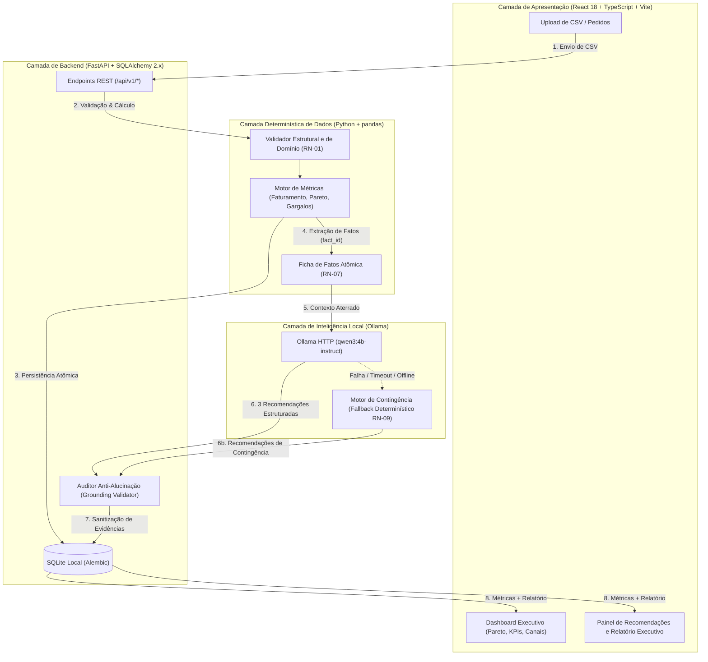

# 🍔 FoodPilot AI — Copiloto de Inteligência Operacional e Financeira para Restaurantes

> **Aplicação 100% Local • Zero Custos de Cloud ou APIs Pagas • Arquitetura Anti-Alucinação com Grounding Factual • Testes Automatizados (Pytest & Vitest)**

[](https://fastapi.tiangolo.com)
[](https://react.dev)
[](https://www.typescriptlang.org)
[](https://www.python.org)
[](https://pandas.pydata.org)
[](https://www.sqlite.org)
[](https://ollama.com)
[](tests/)

---

## 📌 Visão Geral do Produto

O **FoodPilot AI** é um copiloto executivo desenvolvido para gestores de restaurantes, bares e dark kitchens. Ele resolve um dos maiores problemas do setor de alimentação fora do lar: a **falta de visibilidade financeira imediata** e os **gargalos operacionais de atendimento e delivery**, sem exigir mensalidades caras de softwares em nuvem ou expor dados sensíveis do restaurante a APIs externas.

### O Que o FoodPilot AI Faz:
1. **Ingestão e Validação Rigorosa de Vendas:** Importa históricos de pedidos em `.csv` validando 10 regras de domínio com persistência transacional atômica no SQLite.
2. **Cálculos Financeiros e Operacionais Determinísticos:** Processa faturamento bruto, descontos, receita líquida, ticket médio, perdas financeiras com cancelamentos, Curva ABC de Pareto e gargalos de preparo usando exclusivamente **Python e pandas**.
3. **Agente de IA Local e Recomendações Priorizadas:** Utiliza o modelo local **Qwen 4B Instruct** via **Ollama** para gerar exatamente **3 recomendações práticas** fundamentadas nos números, com auditoria anti-alucinação e fallback determinístico transparente.
4. **Dashboard Executivo e Exportação:** Interface web rica em React + TypeScript com visualização por canais, categorias, anomalias e emissão de Relatório Executivo para impressão/PDF.

---

## 🏛️ Arquitetura de Software e Fluxo de Dados

O princípio fundacional do FoodPilot AI é a **Segregação Estrita de Responsabilidades**: **LLMs nunca calculam números**.



---

## 🛡️ O Diferencial Técnico: Arquitetura Anti-Alucinação

Muitas soluções de IA falham na produção porque delegam contas matemáticas e agregação de dados ao modelo generativo, gerando desconfiança por respostas imprecisas. No FoodPilot AI, adotamos o padrão **Grounding Factual com Ficha de Fatos**:

| Abordagem Ingênua de IA | Arquitetura FoodPilot AI |
| :--- | :--- |
| Envia o CSV bruto para o LLM calcular o faturamento. | **Python + pandas** calculam 100% das métricas financeiras. |
| O LLM inventa porcentagens e valores aproximados. | Toda métrica recebe um identificador único (`fact_id`) em uma **Ficha de Fatos** imutável. |
| Aceita qualquer texto livre gerado pelo modelo. | **Auditor de Aterramento** no backend bloqueia números inventados no texto livre. |
| A interface exibe valores calculados pela IA. | O backend **sobrescreve** os valores de evidência com os dados oficiais do banco. |
| Se a API cair, a aplicação quebra com erro 500. | **Fallback Determinístico:** se o Ollama estiver offline, o motor de contingência gera as recomendações instantaneamente sem erro 5xx. |

---

## 📋 Regras de Negócio Implementadas (RN-01 a RN-10)

Todas as regras foram implementadas com base nos contratos formais e provadas com testes automatizados:

* **RN-01 — Validação Estrita de Ingestão de CSV:** Valida as 10 colunas obrigatórias, cabeçalhos, tipos numéricos, enumerações de canal (`delivery`, `salao`, `takeaway`) e consistência intra-pedido.
* **RN-02 — Persistência Atômica e Rastreabilidade SQLite:** Operações de upload e itens de pedido em transação única com `CASCADE` e rollback em caso de falha.
* **RN-03 — Segregação de Cancelados no Faturamento:** Pedidos `canceled` jamais contaminam o faturamento bruto ou líquido, sendo computados separadamente como métrica de perda financeira.
* **RN-04 — Ticket Médio Baseado em Pedidos Únicos:** O denominador do ticket médio considera pedidos distintos (`valid_orders_count`), imune a duplicidades em pedidos com múltiplos itens.
* **RN-05 — Curva ABC de Produtos (Princípio de Pareto):** Ordenação estrita por faturamento decrescente e desempate alfabético, classificando em Classe A (até 80%), Classe B (80% a 95%) e Classe C (restante).
* **RN-06 — Diagnóstico de Gargalos e Anomalias:** Monitoramento contínuo de tempo de preparo (> 30 min) e taxa de cancelamento (> 10%), gerando alertas de severidade `warning` e `critical`.
* **RN-07 — Ficha de Fatos Determinística:** Geração de catálogo padronizado com identificadores atômicos imutáveis (`thr.*`, `fin.*`, `bot.*`, `chan.*`, `cat.*`, `abc.*`).
* **RN-08 — Auditoria de Aterramento e Anti-Alucinação:** Validação de 3 recomendações estritas, rejeição de `fact_id` falso e sanitização dos valores oficiais das evidências.
* **RN-09 — Degradação Graciosa e Fallback Determinístico:** Ativação instantânea de recomendações baseadas em regras de contingência caso o LLM esteja inacessível ou falhe após 1 retry corretivo.
* **RN-10 — Persistência e Auditoria de Recomendações:** Armazenamento de cada execução em `recommendation_runs` com metadados de modelo, prompt e warnings.

---

## ⚡ Quickstart — Como Rodar em 3 Minutos

### Pré-requisitos
* **Python 3.12+** instalado.
* **Node.js 18+** / npm instalados.
* *(Opcional)* **Ollama** com o modelo `qwen3:4b-instruct` para execução da IA local (`ollama run qwen3:4b-instruct`).

### 1. Inicialização Automática com 1 Clique (Windows)
Basta dar um duplo clique no script:
```cmd
run.bat
```
O script ativará o ambiente virtual, iniciará a API FastAPI na porta 8000, o Dashboard React na porta 5173 e abrirá automaticamente seu navegador!

---

### 2. Inicialização Manual Passo a Passo

#### Passo A: Backend (FastAPI + SQLite)
```powershell
# Cria e ativa o ambiente virtual
python -m venv .venv
.venv\Scripts\activate

# Instala dependências
pip install -r requirements.txt

# Inicia a API REST na porta 8000
python -m uvicorn backend.main:app --reload --port 8000
```
* Swagger Docs disponível em: **`http://localhost:8000/docs`**

#### Passo B: Front-end (React + Vite)
```powershell
# Em outro terminal, na pasta frontend:
npm.cmd install --prefix frontend
npm.cmd run dev --prefix frontend
```
* Dashboard interativo disponível em: **`http://localhost:5173`**

#### Passo C: Testando com a Amostra
1. Abra `http://localhost:5173`.
2. No painel de upload, selecione o arquivo de referência **`data/sample_orders.csv`**.
3. Clique em **"Enviar e Processar CSV"** e veja o dashboard e as recomendações carregarem instantaneamente.

---

## 🧪 Bateria de Testes Automatizados

O projeto possui cobertura completa de testes unitários, de integração, contratos e interface:

```powershell
# 1. Executa a suíte de testes de Backend e Dados (Pytest)
.venv\Scripts\python -m pytest tests/ -v
# Resultado: 67 passed, 1 skipped em 1.55s (100% verde)

# 2. Executa a suíte de testes de Interface (Vitest)
npm.cmd test --prefix frontend -- --run
# Resultado: 11 passed em 3.29s (100% verde)

# 3. Compilação de Produção do Front-end (TypeScript + Vite)
npm.cmd run build --prefix frontend
# Resultado: 37 modules transformed, built in 823ms (0 erros de tipagem)
```

---

## 📁 Estrutura do Repositório

```text
FoodPilot AI/
├── backend/                 # API REST FastAPI, modelos SQLAlchemy 2.x e Alembic
│   ├── ai/                  # Camada de IA (OllamaClient, prompts, grounding, service)
│   ├── alembic/             # Migrações versionadas do SQLite (0001, 0002)
│   ├── database.py          # Conexão transacional SQLite
│   ├── main.py              # Endpoints REST (/health, /uploads, /metrics, /ai, /report)
│   ├── models.py            # Modelos ORM (Upload, OrderItem, RecommendationRun)
│   └── schemas.py           # Schemas Pydantic v2
├── data/                    # Datasets de demonstração e homologação
│   └── sample_orders.csv    # Amostra canônica com 82 linhas de pedidos
├── data_pipeline/           # Motor determinístico puro em Python + pandas
│   ├── insights.py          # Ficha de Fatos (RN-07) e Fallback Determinístico (RN-09)
│   ├── metrics.py           # Cálculos de faturamento, ticket médio, Pareto e gargalos
│   └── validator.py         # Validador de schema e integridade do CSV (RN-01)
├── docs/                    # Documentação técnica e governança do projeto
│   ├── contrato.md          # Contrato formal da API REST v1.2.0
│   ├── matriz-de-regras.md  # Rastreabilidade de RN-01 a RN-10
│   ├── dados/               # Data cards e catálogo da Ficha de Fatos
│   ├── apresentacao/        # Roteiro do vídeo de demonstração e pitch
│   └── frontend/            # Arquitetura e acessibilidade de interface
├── entregas/                # Registro formal das entregas (0001 a 0004 aceitas)
├── frontend/                # Aplicação web React 18 + TypeScript + Vite
│   └── src/
│       ├── components/      # Componentes modulares com acessibilidade WCAG AA
│       ├── services/        # Cliente HTTP centralizado e tratamento de erros
│       └── __tests__/       # Testes de comportamento de interface em Vitest
├── tests/                   # Bateria automatizada de testes pytest
│   ├── conftest.py          # Fixtures e cliente ASGI síncrono isolado
│   ├── test_ai_grounding.py # Testes da auditoria anti-alucinação
│   ├── test_ai_service.py   # Testes do orquestrador de IA com FakeLLMClient
│   ├── test_insights.py     # Testes da Ficha de Fatos e regras de contingência
│   └── test_report.py       # Testes do endpoint de relatório executivo
└── run.bat                  # Inicializador unificado com 1 clique para Windows
```

---

## 🏆 Submissão ao iFood AI Builder

Desenvolvido com foco em demonstrar **arquitetura de software robusta**, **domínio pleno de TypeScript e Python**, **inteligência de negócios para alimentação fora do lar** e **uso responsável e econômico de inteligência artificial**.
