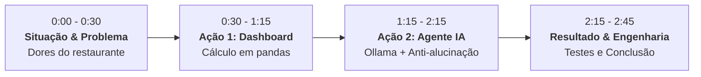

# Roteiro de Demonstração em Vídeo & Pitch — FoodPilot AI

> **Público-Alvo:** Avaliadores técnicos e banca do **iFood AI Builder**  
> **Duração Alvo:** 2 a 3 minutos • **Formato:** Gravação de tela com câmera no canto (Loom / OBS)  
> **Dataset de Demonstração:** `data/sample_orders.csv`

---

## Estrutura do Pitch (Metodologia STAR)

---

### Bloco 1 (0:00 – 0:30) • O Problema e a Proposta de Valor
* **O que mostrar na tela:** Página inicial do FoodPilot AI (`http://localhost:5173`) com o cabeçalho executivo e o selo de IA Local.
* **O que falar:**
  > *"Olá, avaliadores do iFood AI Builder! Eu sou [Seu Nome] e este é o **FoodPilot AI**, um copiloto de inteligência operacional e financeira desenvolvido para restaurantes e dark kitchens.*  
  > *Todo dono de restaurante enfrenta dois grandes desafios: excesso de planilhas desorganizadas e a tentação de usar IAs generativas que alucinam e erram cálculos financeiros básicos. O FoodPilot AI resolve isso com uma arquitetura híbrida: **cálculos matemáticos 100% determinísticos em Python e pandas**, combinados com um **agente de IA local via Ollama** que interpreta os dados sem gastar um centavo com APIs pagas e sem vazar informações do negócio."*

---

### Bloco 2 (0:30 – 1:15) • Ingestão, KPIs e Curva ABC
* **O que mostrar na tela:**
  1. Arraste ou selecione o arquivo `data/sample_orders.csv` no `UploadPanel`.
  2. Clique em **"Enviar e Processar CSV"**.
  3. Mostre o carregamento instantâneo da grade de KPIs financeiros.
  4. Mostre a Curva ABC (filtre por Classe A, B e C) e a quebra por canais (Delivery vs. App vs. Balcão).
* **O que falar:**
  > *"Com um simples envio de CSV de pedidos, o sistema valida atomicamente o arquivo segundo 10 regras estritas de domínio, persiste no SQLite e calcula instantaneamente o Faturamento Bruto (R$ 5.000), o Faturamento Líquido (R$ 4.750) e os R$ 514 perdidos em cancelamentos.*  
  > *Aqui na Curva ABC, identificamos com precisão matemática os itens que compõem o Princípio de Pareto (80% da receita), como o Combo Burger Duplo, além de anomalias operacionais críticas, como cancelamentos que bateram 20% no canal de entrega."*

---

### Bloco 3 (1:15 – 2:15) • O Agente de IA e a Arquitetura Anti-Alucinação
* **O que mostrar na tela:**
  1. Role a tela até o **`RecommendationsPanel`** (Recomendações Práticas Fundamentadas).
  2. Aponte para as 3 recomendações priorizadas por rank (#1 Delivery, #2 Cozinha, #3 Mix de Cardápio).
  3. Destaque os cartões de **Evidências Fatuais** com seus identificadores canônicos (`fact_id`).
  4. Clique em **"📄 Relatório Executivo"** e abra o modal de visualização e cópia do relatório em Markdown.
* **O que falar:**
  > *"Agora, o coração do FoodPilot AI: o agente de inteligência artificial.*  
  > *Para garantir zero alucinação, a IA **nunca** calcula números. O pipeline gera uma **Ficha de Fatos** atômica imutável com identificadores únicos. A IA local (usando o Qwen 4B no Ollama) analisa essa ficha e gera exatamente **3 recomendações acionáveis** prioritárias.*  
  > *Nosso validador de aterramento no backend audita cada número citado no texto livre e sobrescreve as evidências com os dados oficiais do banco. E caso o Ollama esteja offline ou sofra timeout, o sistema ativa transparentemente um **fallback determinístico**, garantindo que o operador nunca receba um erro 500.*  
  > *Com um clique no Relatório Executivo, o gestor tem um resumo executivo completo pronto para impressão ou envio por WhatsApp."*

---

### Bloco 4 (2:15 – 2:45) • Engenharia de Software e Fechamento
* **O que mostrar na tela:** Abra rapidamente o terminal mostrando os testes passando (`67 passed no pytest` e `11 passed no vitest`).
* **O que falar:**
  > *"Em termos de engenharia, construímos o FoodPilot com padrões de produção: FastAPI com tipagem estrita no backend, React 18 com TypeScript no frontend, migrações com Alembic, acessibilidade WCAG AA e **78 testes automatizados** entre backend e frontend.*  
  > *Tudo roda 100% local no computador do restaurante, com custo zero de infraestrutura e privacidade total dos dados. Estou muito empolgado para aplicar essa visão de engenharia e IA prática no iFood AI Builder. Muito obrigado!"*
