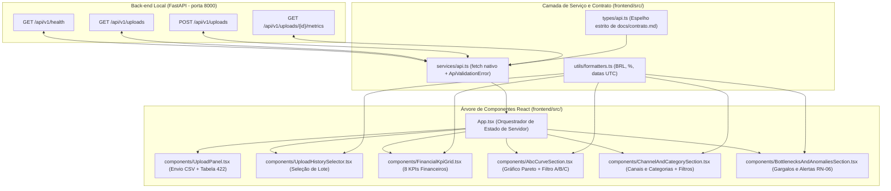

# Design e Arquitetura de Front-end — FoodPilot AI

**Dono:** Sakura (Front-end)  
**Entrega:** 0003 — Agente de IA Local (Ollama qwen3:4b-instruct) e 3 Recomendações Práticas Fundamentadas  
**Atualizado em:** 2026-11-10  
**Contrato Consumido:** [`docs/contrato.md`](../contrato.md) (v1.1.0)

Este documento registra o planejamento visual, o sistema de design (tokens CSS), a arquitetura de componentes, o mapeamento de estados/erros e os requisitos de acessibilidade da camada de apresentação (`frontend/`) do **FoodPilot AI**.

---

## 1. Direção Visual e Hierarquia da Informação

O **FoodPilot AI** é uma ferramenta executiva e operacional para gestores de restaurantes. A direção visual prioriza **clareza analítica, contraste elevado, leitura rápida de tabelas financeiras e destaque imediato para anomalias operacionais**.

### 1.1. Hierarquia da Tela Principal (Dashboard Executivo)

A tela é estruturada em cinco regiões semânticas ordenadas por prioridade de decisão do operador:

1. **Cabeçalho Executivo e Barra de Controle de Lotes (`header` + `section` de Ingestão):**
   - Identidade do produto (*FoodPilot AI — Inteligência Operacional e Financeira Determinística*), selo de execução 100% local e indicador de disponibilidade da API (`GET /api/v1/health`).
   - **Painel de Upload (`UploadPanel`):** seleção e envio de arquivo `.csv` (`POST /api/v1/uploads`), orientações sobre as 10 colunas obrigatórias e tabela de diagnóstico linha/coluna em caso de rejeição (`422` / `400`).
   - **Seletor de Histórico de Lotes (`UploadHistorySelector`):** alternância rápida entre lotes importados (`GET /api/v1/uploads`), exibindo nome do arquivo, data/hora UTC, contagem de linhas (`total_rows`), pedidos concluídos (`valid_orders_count`) e cancelados (`canceled_orders_count`).
2. **Grade de KPIs Financeiros Consolidados (`FinancialKpiGrid`):**
   - Exibe em destaque os 8 indicadores oficiais de `financials` (`gross_revenue`, `discount_total`, `net_revenue`, `average_ticket_gross`, `average_ticket_net`, `valid_orders_count`, `canceled_orders_count`, `canceled_revenue_loss`) e o produto líder da Curva ABC (`top_abc_item` quando disponível no resumo).
   - **Invariante eliminatória:** o front-end **jamais recalcula** faturamento, descontos, ticket médio ou percentuais; apenas formata os números já auditados pelo `data_pipeline/`.
3. **Curva ABC de Produtos e Gráfico de Pareto (`AbcCurveSection`):**
   - Filtro interativo por classe (`Todas`, `Classe A`, `Classe B`, `Classe C`) com botões `aria-pressed`.
   - Visualização gráfica de barras proporcionais de participação individual (`revenue_share_pct`) combinada com indicador de acumulado de Pareto (`cumulative_share_pct`) e marcos de corte (80% para Classe A, 95% para Classe B).
   - Tabela analítica completa com posição, produto (`item_name`), categoria (`category`), quantidade vendida (`quantity_sold`), receita bruta (`revenue`), participação individual (`revenue_share_pct`), participação acumulada (`cumulative_share_pct`) e badge semântico da classe (`abc_class`).
4. **Desempenho por Canal de Venda e Categoria (`ChannelAndCategorySection`):**
   - Subseção **Por Canal (`by_channel`)**: filtro interativo (`Todos`, `delivery`, `app`, `balcao`), cartões visuais com barra de participação no faturamento líquido (`revenue_share_pct`) e tabela com pedidos concluídos (`valid_orders_count`), itens vendidos (`quantity_sold`), faturamento bruto (`gross_revenue`), descontos (`discount_total`), faturamento líquido (`net_revenue`) e ticket médio líquido (`average_ticket_net`).
   - Subseção **Por Categoria (`by_category`)**: filtro interativo por categoria do cardápio, barras de participação (`revenue_share_pct`) e tabela com quantidade vendida, faturamento bruto, descontos, faturamento líquido e tempo médio de preparo (`average_prep_time_minutes`).
5. **Painel de Gargalos Operacionais e Anomalias (`BottlenecksAndAnomaliesSection`):**
   - **Alertas Determinísticos (`anomalies`)**: cartões destacados por severidade (`critical` em vermelho intenso e `warning` em âmbar), exibindo dimensão afetada (`dimension`), tipo (`high_prep_time` ou `high_cancellation_rate`), descrição (`description`), valor medido (`metric_value`) e limiar (`threshold_value`).
   - **Indicadores de Tempo de Preparo**: cartões resumindo limiar configurado (`prep_time_threshold_minutes`), pedidos atrasados (`delayed_orders_count`), itens atrasados (`delayed_items_count`), tempo médio global (`average_prep_time_minutes`) e pico de preparo (`max_prep_time_minutes`).
   - **Tabelas de Diagnóstico Operacional**:
     - Atrasos por Categoria (`delayed_by_category`);
     - Cancelamentos por Canal (`canceled_by_channel`);
     - Cancelamentos por Item do Cardápio (`canceled_by_item`).

---

## 2. Sistema de Design e Tokens CSS

Os tokens residem exclusivamente em [`frontend/src/styles/tokens.css`](../../frontend/src/styles/tokens.css) e são consumidos pelos estilos globais e de componentes em [`frontend/src/styles/global.css`](../../frontend/src/styles/global.css).

### 2.1. Papéis Semânticos de Cor

| Token CSS | Papel Semântico | Valor Padrão | Uso Principal |
| --- | --- | --- | --- |
| `--color-bg-canvas` | Fundo geral da aplicação | `#f8fafc` | `body`, fundo da página |
| `--color-surface` | Superfície de cartões e painéis | `#ffffff` | Cards de KPI, seções, tabelas |
| `--color-surface-subtle` | Superfície secundária/destacada | `#f1f5f9` | Cabeçalhos de tabela, barras de fundo |
| `--color-text-primary` | Texto principal de alto contraste | `#0f172a` | Títulos, valores de KPIs, células principais |
| `--color-text-secondary` | Texto de apoio e metadados | `#475569` | Rótulos, legendas, descrições |
| `--color-text-muted` | Texto auxiliar | `#64748b` | Notas técnicas, dicas de formulário |
| `--color-action-primary` | Ação primária da interface | `#0f766e` | Botão de upload, filtros ativos |
| `--color-action-primary-hover` | Hover da ação primária | `#115e59` | Estado `:hover` de botões primários |
| `--color-border` | Divisórias e contornos de cartões | `#cbd5e1` | Bordas de cartões, inputs e tabelas |
| `--color-focus-ring` | Anel de foco de teclado | `#0284c7` | Contorno `:focus-visible` acessível |
| `--color-success-bg` / `--color-success-text` | Confirmação e saúde operacional | `#ecfdf5` / `#065f46` | Sucesso de upload, status da API, KPI líquido |
| `--color-warning-bg` / `--color-warning-text` | Alerta moderado (`severity: "warning"`) | `#fffbeb` / `#92400e` | Anomalias `warning`, classe B |
| `--color-critical-bg` / `--color-critical-text` | Alerta crítico (`severity: "critical"`) e erro | `#fef2f2` / `#991b1b` | Anomalias `critical`, erros `422`/`400`, perdas |
| `--color-abc-a-bg` / `--color-abc-a-text` | Badge e barra da Classe A (até 80%) | `#dcfce7` / `#166534` | Itens líderes de faturamento na Curva ABC |
| `--color-abc-b-bg` / `--color-abc-b-text` | Badge e barra da Classe B (80%–95%) | `#fef3c7` / `#92400e` | Itens intermediários na Curva ABC |
| `--color-abc-c-bg` / `--color-abc-c-text` | Badge e barra da Classe C (> 95%) | `#e2e8f0` / `#334155` | Cauda longa do cardápio na Curva ABC |

### 2.2. Tipografia, Espaçamento e Responsividade

- **Fontes:** `--font-sans` (`'Inter', -apple-system, BlinkMacSystemFont, 'Segoe UI', Roboto, sans-serif`) para leitura geral e `--font-mono` (`'JetBrains Mono', 'Fira Code', Consolas, monospace`) com `font-variant-numeric: tabular-nums` para alinhamento vertical perfeito de cifras monetárias, percentuais e números de linha em tabelas.
- **Escala de Espaço:** `--space-1` (`0.25rem`) a `--space-10` (`3rem`).
- **Breakpoints:**
  - Até `768px` (telas estreitas / mobile): empilhamento vertical em coluna única, tabelas com rolagem horizontal segura (`overflow-x: auto`) preservando cabeçalhos.
  - Acima de `768px` e `1024px` (telas largas / desktop): grade executiva de 2 a 4 colunas para KPIs e layout lado a lado para ingestão + histórico e quebras analíticas.

---

## 3. Arquitetura do Front-end e Fluxo de Dados

### 3.1. Divisão de Responsabilidades

- [`frontend/src/types/api.ts`](../../frontend/src/types/api.ts): Definições TypeScript que refletem campo a campo `docs/contrato.md` (§2.1 a §2.4).
- [`frontend/src/services/api.ts`](../../frontend/src/services/api.ts): Ponto único de comunicação HTTP (`checkHealth`, `listUploads`, `uploadOrdersCsv`, `getUploadMetrics`) e classes de erro tipadas (`ApiValidationError` para `400`/`422` com `detail` e `errors`, e `ApiHttpError` para demais falhas HTTP/rede).
- [`frontend/src/utils/formatters.ts`](../../frontend/src/utils/formatters.ts): Funções puras de apresentação visual (`formatCurrencyBRL`, `formatPercent`, `formatMinutes`, `formatDateTimeUTC`, `formatChannelLabel`). Nenhuma função realiza cálculo de regra de negócio.
- [`frontend/src/App.tsx`](../../frontend/src/App.tsx): Orquestra o carregamento inicial (`listUploads` e `checkHealth`), mantém o `selectedUploadId` e os dados de `UploadMetricsResponse` do lote ativo, e coordena a atualização automática após um upload bem-sucedido (`201 Created`).
- Componentes em [`frontend/src/components/`](../../frontend/src/components/): Componentes desacoplados e orientados a props, mantendo apenas estado efêmero de UI (como o arquivo selecionado no input ou o filtro ativo de classe/canal/categoria).

---

## 4. Mapeamento de Estados e Tratamento de Erros

Seguindo o guia [`.Agents/time/Sakura/design/estados-e-erros.md`](../../.Agents/time/Sakura/design/estados-e-erros.md):

| Estado / Situação | Onde ocorre | Comportamento na Interface |
| --- | --- | --- |
| **Carregando histórico inicial** | `App.tsx` ao montar | Exibe indicador acessível (`role="status"`, `aria-live="polite"`) preservando a estrutura da página. |
| **Estado Vazio (`total === 0`)** | `App.tsx` / `UploadHistorySelector` | Quando `GET /api/v1/uploads` retorna `{"items": [], "total": 0}`, exibe painel orientativo explicando que nenhum lote foi importado ainda e destacando o passo a passo para enviar o primeiro CSV no `UploadPanel`. |
| **Enviando CSV (`loading`)** | `UploadPanel.tsx` | Botão de envio exibe texto `"Processando lote CSV..."`, recebe `disabled` e `aria-busy="true"`, impedindo duplo envio. |
| **Erro de Validação (`400` / `422`)** | `UploadPanel.tsx` | Exibe bloco `role="alert"` com a mensagem principal (`detail`) e uma tabela estruturada listando cada item de `errors` com **Linha (`row` ou `"Arquivo/Cabeçalho"` quando `null`)**, **Coluna (`column` ou `"Geral"` quando `null`)** e **Mensagem (`message`)**, preservando o contexto para correção. |
| **Sucesso no Upload (`201 Created`)** | `UploadPanel.tsx` + `App.tsx` | Anuncia confirmação em região `role="status"`, adiciona/atualiza o lote no seletor de histórico, seleciona automaticamente o novo `upload_id` e carrega seu dashboard completo via `GET /api/v1/uploads/{upload_id}/metrics`. |
| **Filtro sem resultados** | `AbcCurveSection` / `ChannelAndCategorySection` | Diferencia do vazio inicial: informa que nenhum item corresponde ao filtro selecionado e oferece botão imediato para limpar o filtro (`Mostrar todas`). |
| **Erro `404` ou Falha de Rede** | `App.tsx` | Exibe alerta claro (`role="alert"`) distinguindo indisponibilidade de conexão ou lote ausente e oferece botão `"Tentar novamente"` que refaz a sincronização. |

---

## 5. Acessibilidade (WCAG AA)

Seguindo o guia [`.Agents/time/Sakura/design/acessibilidade.md`](../../.Agents/time/Sakura/design/acessibilidade.md):

1. **Semântica HTML Nativa:** Uso de `<header>`, `<main>`, `<section aria-labelledby="...">`, `<form>`, `<label htmlFor="...">`, `<button type="button">`, `<table>`, `<thead>`, `<th scope="col">` e `<caption>` descritivo.
2. **Anúncio Dinâmico para Leitores de Tela:**
   - Mensagens de erro de validação CSV (`400`/`422`) e falhas de comunicação usam `role="alert"` (`aria-live="assertive"` implícito).
   - Estados de carregamento e mensagens de sucesso no upload usam `role="status"` e `aria-live="polite"`.
3. **Navegação por Teclado e Foco Visível:**
   - Todos os controles interativos (input de arquivo, botão de envio, `<select>` de histórico de lotes, botões de filtro de classe ABC, canal e categoria) são elementos nativos focáveis via `Tab` e acionáveis por `Enter` / `Espaço`.
   - Estilo `:focus-visible` global com contorno sólido de `3px` em `--color-focus-ring` e `outline-offset: 2px`.
4. **Independência de Cor:**
   - Classes ABC (`A`, `B`, `C`) e severidades de anomalias (`critical`, `warning`) nunca dependem apenas da cor: exibem rótulos textuais explícitos (`"Classe A"`, `"Crítico"`, `"Atenção"`) e ícones/símbolos de apoio.
5. **Movimento Reduzido:**
   - Regra `@media (prefers-reduced-motion: reduce)` desativa transições e animações decorativas em `global.css`.

---

## 6. Painel de Recomendações e Monitoramento de IA Local (Entrega 0003)

Na Entrega 0003, o front-end incorpora a camada de inteligência com o **`AiStatusBadge`** e o **`RecommendationsPanel`**:

### 6.1. Monitoramento do Ollama (`AiStatusBadge`)
- Consulta `GET /api/v1/ai/status` (§2.5 de `docs/contrato.md`).
- Exibe o estado em tempo real no cabeçalho:
  - **Online:** Servidor Ollama ativo e modelo `qwen3:4b-instruct` carregado.
  - **Modelo Ausente:** Ollama acessível, mas o modelo não está disponível localmente (fallback determinístico ativo).
  - **Offline:** Servidor Ollama indisponível; o sistema exibe badge âmbar informando que o fallback determinístico está ativo (`RN-09`).
  - Botão integrado para re-verificação sem necessidade de recarregar a página inteira.

### 6.2. Painel Executivo de Recomendações (`RecommendationsPanel`)
- Exibe as 3 recomendações priorizadas (`RN-07` a `RN-10`), ordenadas pelos ranks 1, 2 e 3.
- Cada cartão apresenta:
  - **Badge de Prioridade:** Rank 1, 2 ou 3 com rótulo semântico do tema (`Canais e Delivery`, `Tempo de Preparo e Gargalos`, `Mix de Produtos e Curva ABC`).
  - **Diagnóstico:** Explicação executiva do problema operacional detectado.
  - **Ação Prática:** Passos concretos recomendados para o operador do restaurante.
  - **Impacto Esperado:** Estimativa de ganho financeiro ou redução de perdas.
  - **Grade de Evidências Oficiais:** Cada fato (`fact_id`) é exibido em cartão destacado com seu rótulo oficial, valor e unidade formatados (`RN-07`).
  - **Invariante de Exibição:** O front-end **nunca** recalcula números nem extrai valores do texto livre; consome diretamente os valores sanitizados de `evidence[].value` entregues pela API.
  - **Badge de Origem e Auditoria:** Exibe claramente se as recomendações foram geradas pelo modelo local (`Ollama qwen3:4b-instruct`) ou pelo motor de regras determinísticas (`Fallback Ativo`), além da versão do prompt (`rec-v1`) e data/hora UTC da geração.
  - **Botão de Regeneração:** Permite disparar nova rodada de análise via `POST /api/v1/uploads/{upload_id}/recommendations`.

