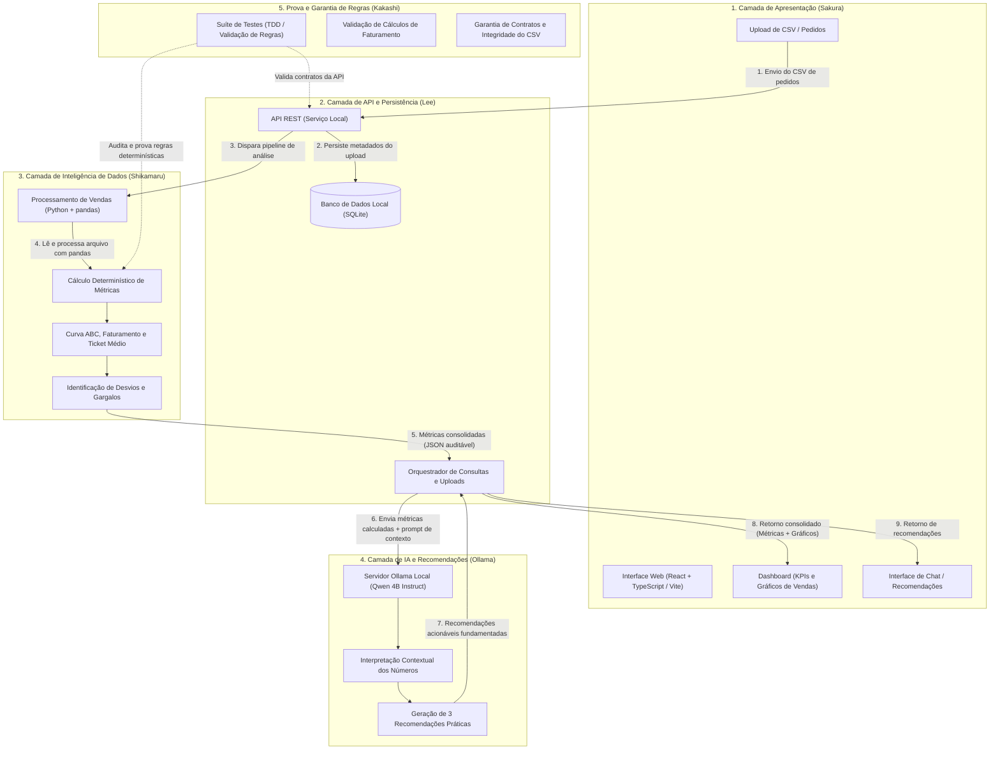

# Mapa do projeto — FoodPilot AI

**Atualizado em** 2026-11-09 · **Dono** Tsunade
**Escopo** Repositório `C:\Users\klebe\OneDrive\Documentos\ChatGPT\FoodPilot AI` (aplicação 100% local de inteligência operacional e financeira para restaurantes via upload de CSV, processamento determinístico em Python + pandas, dashboard web e recomendações via LLM local Ollama `qwen3:4b-instruct`). Estão fora de escopo serviços em nuvem pagos, integrações diretas com ERPs/PDVs externos e APIs proprietárias de LLMs.

## Stack

Conforme [`.Agents/comum/stacks.md`](../.Agents/comum/stacks.md) e decisão registrada em [`docs/decisoes/0001-stack-backend.md`](decisoes/0001-stack-backend.md):

- **Back-end (Lee):** Python 3.12+ (rodando em `Python 3.14.5` dentro de `.venv`), FastAPI `0.162.2` com Pydantic `2.14.3`, persistência em SQLite via SQLAlchemy `2.1.8` e migrações com Alembic `1.20.1`. Testes com `pytest 9.2.0`.
- **Front-end (Sakura):** Node.js `v26.13.0` / npm `11.20.0`, React 18 com TypeScript 5, build por Vite `6.4.6`, estilização em CSS com tokens do projeto (`frontend/src/styles/tokens.css`), testes com Vitest `2.1.9` e Testing Library (`frontend/src/__tests__/Dashboard.test.tsx`).
- **Dados e Inteligência Determinística (Shikamaru):** Python com `pandas 3.1.1`, `numpy 2.5.4` e `matplotlib 3.11.2` para validação de schema de CSV (`RN-01`), cálculo determinístico de faturamento (`RN-03`), ticket médio (`RN-04`), curva ABC (`RN-05`) e detecção de desvios/gargalos (`RN-06`).
- **IA Local (Ollama):** Servidor local Ollama executando o modelo `qwen3:4b-instruct` (programado para a Entrega 0003, consumido via HTTP local apenas para interpretação textual das métricas já calculadas e geração de 3 recomendações práticas fundamentadas nos números).
- **Banco de Dados:** SQLite local (`foodpilot.db` gerenciado via SQLAlchemy 2.x + Alembic).

## Como rodar

| Comando | O que faz | Verificado em |
| --- | --- | --- |
| `& "C:\Users\klebe\AppData\Local\Programs\Python\Python314\python.exe" --version` | Verifica o interpretador Python (`Python 3.14.5`) disponível na máquina | 2026-11-09 |
| `& "C:\Program Files\nodejs\node.exe" --version` / `& "C:\Program Files\nodejs\npm.cmd" --version` | Verifica Node.js (`v26.13.0`) e npm (`11.20.0`) instalados | 2026-11-09 |
| `git --version` | Verifica o Git instalado (`git version 2.45.1.windows.1`) | 2026-11-09 |
| `.venv\Scripts\python.exe -m pytest -v` | Executa a suíte de 53 testes automatizados (`RN-01` a `RN-06`, contratos e SQLite) em `0.84s` | 2026-11-09 |
| `.venv\Scripts\python.exe -m alembic upgrade head` | Aplica migrações do banco SQLite local (`uploads` e `order_items`) | 2026-11-09 |
| `.venv\Scripts\python.exe -m uvicorn backend.main:app --reload` | Inicia o servidor local da API REST na porta `8000` | 2026-11-09 |
| `& "C:\Program Files\nodejs\npm.cmd" --prefix frontend install` | Instala dependências do front-end e atualiza `package-lock.json` | 2026-11-09 |
| `& "C:\Program Files\nodejs\npm.cmd" --prefix frontend test` | Executa a suíte de 5 testes de interface em Vitest + Testing Library (`5 passed in 862ms`) | 2026-11-09 |
| `& "C:\Program Files\nodejs\npm.cmd" --prefix frontend run build` | Executa `tsc -b && vite build` (`35 modules transformed`, `built in 658ms`) | 2026-11-09 |
| `& "C:\Program Files\nodejs\npm.cmd" --prefix frontend run dev` | Sobe o servidor de desenvolvimento Vite do Dashboard na porta `5173` | 2026-11-09 |
| `ollama run qwen3:4b-instruct` | Inicializa o modelo local `qwen3:4b-instruct` no Ollama (`ollama` ausente no PATH atual) | a verificar |

## Estrutura

Estado atual do diretório após a conclusão e aceite das **Entregas 0001 e 0002**:

```text
FoodPilot AI/
├── .Agents/                  # Governança do time, skills, modelos e regras de cada agente
├── .venv/                    # Ambiente virtual Python 3.14.5 com todas as dependências instaladas
├── backend/                  # API REST FastAPI, modelos SQLAlchemy 2.x, schemas Pydantic v2 e Alembic (dono: Lee)
│   ├── alembic/              # Ambiente de migrações e versão 0001_initial_schema.py
│   ├── database.py           # Engine SQLite (PRAGMA foreign_keys=ON), SessionLocal e get_db
│   ├── main.py               # Rotas /api/v1/health, /api/v1/uploads e /api/v1/uploads/{id}/metrics
│   ├── models.py             # Entidades Upload e OrderItem
│   └── schemas.py            # Contratos Pydantic v2 de entrada e saída
├── data/                     # Datasets de referência (dono: Shikamaru)
│   └── sample_orders.csv     # Dataset simulado canônico (82 linhas, 50 pedidos concluídos, 5 cancelados)
├── data_pipeline/            # Motor determinístico em Python + pandas (dono: Shikamaru)
│   ├── __init__.py           # Interface pública (CSVValidationError, validate_and_parse_csv, calculate_metrics)
│   ├── exceptions.py         # Exceção estruturada CSVValidationError
│   ├── metrics.py            # Cálculo exato de faturamento, ticket médio, Curva ABC, gargalos e quebras
│   └── validator.py          # Validação completa de schema, tipos, limites e consistência intra-pedido
├── frontend/                 # Aplicação web React + TypeScript + Vite (dono: Sakura)
│   ├── package.json          # Dependências React, Vite, Vitest e Testing Library
│   ├── package-lock.json     # Lockfile gerado pelo npm 11.20.0
│   ├── tsconfig.json         # Configuração estrita TypeScript
│   ├── vite.config.ts        # Build Vite, proxy /api e configuração Vitest (jsdom)
│   ├── index.html            # Documento raiz pt-BR
│   └── src/
│       ├── App.tsx           # Orquestrador do Dashboard, Upload e Histórico de Lotes
│       ├── types/api.ts      # Contratos TypeScript (16 interfaces, 88 campos espelhando docs/contrato.md)
│       ├── services/api.ts   # Cliente HTTP fetch (/api/v1/health, /api/v1/uploads, /api/v1/uploads/{id}/metrics)
│       ├── utils/formatters.ts # Formatadores puros BRL, %, minutos e datas UTC
│       ├── styles/           # Sistema de design (tokens.css e global.css)
│       ├── components/       # UploadPanel, UploadHistorySelector, FinancialKpiGrid, AbcCurveSection, ChannelAndCategorySection, BottlenecksAndAnomaliesSection
│       └── __tests__/        # Suíte de testes de comportamento da interface (Dashboard.test.tsx — 5 passed)
├── docs/                     # Documentação viva e fontes da verdade do projeto
│   ├── mapa-do-projeto.md    # Este mapa atualizado
│   ├── contrato.md           # Contrato congelado da API REST e interface interna Python (dono: Lee)
│   ├── matriz-de-regras.md   # Rastreabilidade e prova das regras RN-01 a RN-06 (Lee/Shikamaru/Kakashi)
│   ├── dominio/              # Guia de domínio: pedidos-e-metricas.md (dono: Lee)
│   ├── dados/                # Data card oficial: pedidos-csv.md (dono: Shikamaru)
│   ├── decisoes/             # ADR 0001-stack-backend.md (dono: Lee)
│   └── frontend/             # Documentação de design e arquitetura: design-e-arquitetura.md (dono: Sakura)
├── entregas/                 # Planos formais de entrega (0001 aceita, 0002 aceita)
├── problemas/                # Registros de problemas observados e triados (0 abertos)
├── relatorios/               # Fechamentos do dia (dono: Tsunade)
├── tests/                    # Suíte automatizada com 53 testes em pytest (dono: Kakashi)
├── alembic.ini               # Configuração do Alembic para SQLite
├── pyproject.toml            # Configuração do projeto e do pytest
└── requirements.txt          # Lista de pacotes Python de back-end, dados e testes
```

### Arquitetura do Fluxo de Dados e Camadas



## Estado

- **Funciona:**
  - **Camada de Dados (`data_pipeline/` + `data/sample_orders.csv`):** Validação completa de CSV (`RN-01`), cálculo determinístico de faturamento (`RN-03`), ticket médio (`RN-04`), Curva ABC (`RN-05`), gargalos/anomalias (`RN-06`), Ficha de Fatos atômica (`RN-07`) e motor de contingência determinístico (`RN-09`).
  - **Camada de API e Persistência (`backend/` + `SQLite`):** Endpoints REST operacionais (`GET /health`, `POST/GET /uploads`, `GET /uploads/{id}/metrics`, `GET /ai/status`, `POST/GET /uploads/{id}/recommendations`, `GET /uploads/{id}/report`), migrações Alembic (`0001_initial_schema`, `0002_recommendations`) e atomicidade transacional (`RN-02`, `RN-10`).
  - **Agente de IA Local e Auditoria de Aterramento (`backend/ai/`):** Cliente Ollama desacoplado (`OllamaClient`), prompts com JSON schema estrito, auditor anti-alucinação (`validate_recommendations` — `RN-08`), retry corretivo e fallback determinístico transparente.
  - **Dashboard Web, Recomendações e Relatório Executivo (`frontend/`):** React 18 + TypeScript + Vite com painel de upload, visualização de Curva ABC (Pareto), quebras por canal e categoria, alertas operacionais, painel de recomendações (`RecommendationsPanel`), monitor de IA (`AiStatusBadge`), modal de relatório executivo e exportação para impressão/PDF (`@media print`).
  - **Suíte de Testes Automatizados:** 69 testes no `pytest` (+ 1 skipped live Ollama) + 11 testes no `vitest` + build de produção Vite (`100% verde`).
- **Pela metade:**
  - Nenhuma. O MVP completo está 100% implementado e integrado de ponta a ponta.
- **Quebrado:**
  - Nenhum. Todos os testes passam e o build de produção compila sem erros.
- **Sem teste:**
  - Nenhuma camada desprovida de testes automatizados.

## Fontes da verdade

| Fonte | Onde | Estado |
| --- | --- | --- |
| Contrato | [`docs/contrato.md`](contrato.md) | atualizado (v1.2.0 — Entregas 0001 a 0004) |
| Guia de domínio | [`docs/dominio/pedidos-e-metricas.md`](dominio/pedidos-e-metricas.md) | atualizado (regras `RN-01` a `RN-10`) |
| Decisões | [`docs/decisoes/`](decisoes/) | ADRs 0001 (Stack Backend) e 0002 (IA Local Ollama) aceitas |
| Design de Front-end | [`docs/frontend/design-e-arquitetura.md`](frontend/design-e-arquitetura.md) | atualizado com painel de recomendações e impressão |
| Matriz de regras | [`docs/matriz-de-regras.md`](matriz-de-regras.md) | atualizado (`RN-01` a `RN-10` provadas) |
| Ficha de Fatos | [`docs/dados/ficha-de-fatos.md`](dados/ficha-de-fatos.md) | catálogo oficial de identificadores atômicos |
| Pitch e Demonstração | [`docs/apresentacao/roteiro-demo-pitch.md`](apresentacao/roteiro-demo-pitch.md) | roteiro de 2 a 3 minutos para vídeo do iFood AI Builder |
| Registros abertos | `problemas/` | 0 registros abertos |


## Riscos

1. **Ausência de `ollama` no PATH para a Entrega 0003:** Exige que a integração com `qwen3:4b-instruct` seja construída com cliente HTTP desacoplado, fallback determinístico claro quando o servidor Ollama local estiver offline e suíte de testes com dublês verificáveis em `pytest` e `vitest`.

## O que cada camada precisa saber

| Camada | Onde olhar | O que evitar |
| --- | --- | --- |
| Back-end (Lee) | `docs/contrato.md`, `docs/dominio/pedidos-e-metricas.md`, `backend/` | Não duplicar lógica de `data_pipeline/` dentro das rotas FastAPI. |
| Front-end (Sakura) | `docs/contrato.md`, `docs/frontend/design-e-arquitetura.md`, `frontend/` | Jamais recalcular métricas financeiras no cliente; usar `npm.cmd` para scripts. |
| Teste (Kakashi) | `tests/conftest.py`, `docs/matriz-de-regras.md`, `frontend/src/__tests__/` | Usar `SyncASGIClient` em `tests/conftest.py` no sandbox Windows. |
| Dados (Shikamaru) | `data_pipeline/`, `docs/dados/pedidos-csv.md`, `docs/matriz-de-regras.md` | Manter `validate_and_parse_csv` e `calculate_metrics` 100% puros e determinísticos. |

## Lacunas

- **Binário `ollama`:** Ainda não encontrado no PATH da máquina Windows para testes ao vivo do LLM local na Entrega 0003.
